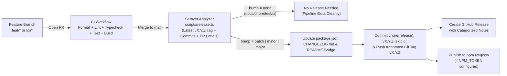

# Contributing & Release Workflow (`ebird-mcp`)

All development on `ebird-mcp` follows a structured **branch-based Pull Request workflow** paired with an **automated Semantic Versioning (SemVer) release pipeline** powered by GitHub Actions.

---

## 1. Branch-Based Development Flow

Never commit feature or fix work directly to `main`. All changes must be developed on dedicated branches and merged via Pull Request:

1. **Create a Dedicated Branch from `main`:**
   - `feat/<short-name>` — New MCP tools, helpers, resources, or capabilities
   - `fix/<short-name>` — Bug fixes, parameter handling, or schema updates
   - `perf/<short-name>` — Taxonomy caching or query optimizations
   - `docs/<short-name>` — Documentation updates
   - `chore/<short-name>` / `ci/<short-name>` — Build, dependency, or workflow updates

   ```bash
   git checkout main
   git pull origin main
   git checkout -b feat/my-new-feature
   ```

2. **Implement & Add Tests:**
   - Add unit tests under `test/` covering both successful responses and error branches.
   - Run tests with `npm test`.

3. **Run Local Verification:**

   ```bash
   npm run format:check
   npm run lint
   npm run typecheck
   npm test
   npm run build
   npm run release:check
   ```

4. **Open a Pull Request to `main`:**
   - Pushing your branch automatically runs the **CI workflow** (`.github/workflows/ci.yml`).
   - Optionally attach a semver label (`semver:major`, `semver:minor`, `semver:patch`, or `semver:skip`) to explicitly control the release bump when merged.

---

## 2. Automated Semantic Release Pipeline (`.github/workflows/release.yml`)

Whenever a Pull Request is merged (or commits are pushed) to `main`, the **Release & Publish** workflow runs automatically:



### Commit Message Conventions

Commit messages determine automated version bumping:

| Commit Type                             | SemVer Bump                     | Example                                        |
| --------------------------------------- | ------------------------------- | ---------------------------------------------- |
| `feat:` / `feature:`                    | **Minor** (`1.1.0` -> `1.2.0`)  | `feat: add regional checklist export`          |
| `fix:` / `bugfix:` / `perf:`            | **Patch** (`1.1.0` -> `1.1.1`)  | `fix: resolve coordinate validation edge case` |
| Any type with `!` or `BREAKING CHANGE:` | **Major** (`1.1.0` -> `2.0.0`)  | `feat!: overhaul endpoint response shape`      |
| `docs:` / `chore:` / `test:` / `ci:`    | **None** (No release triggered) | `docs: update setup instructions`              |

---

## 3. Local Release Testing

To simulate the semver analysis locally:

```bash
# Check what bump would be computed based on commits since the last tag:
npm run release:check

# Force a specific bump calculation (e.g. patch, minor, major):
npx tsx scripts/release.ts --bump minor
```
