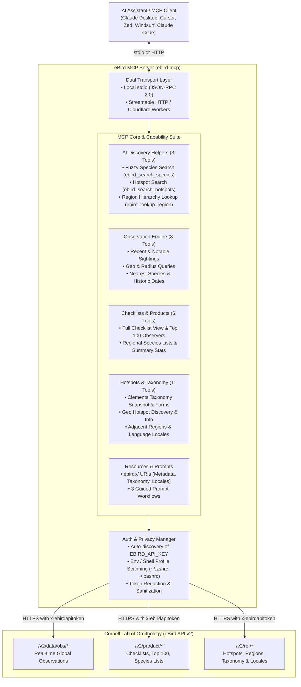

# ebird-mcp

[](https://github.com/thesven/ebird-mcp/actions/workflows/ci.yml)
[](package.json)
[](LICENSE)
[](<>)
[](<>)
[](https://modelcontextprotocol.io)

A comprehensive, production-grade [Model Context Protocol (MCP)](https://modelcontextprotocol.io) server for the [eBird v2 API](https://documenter.getpostman.com/view/664302/S1ENwy59) by the [Cornell Lab of Ornithology](https://www.birds.cornell.edu/).

Seamlessly connects LLMs and AI agent runtimes (Claude Desktop, Cursor, Zed, Windsurf, Claude Code, Goose, and custom agents) to global real-time bird observations, submitted checklists, birding hotspots, and authoritative Clements avian taxonomy.

---

## Architecture Overview



---

## Key Highlights

- **Complete API Coverage (25 Core Endpoints + 3 AI Helpers)**: Full implementation of all documented eBird v2 REST services across observations, hotspots, products, and references.
- **AI Helper Tools**: Built-in fuzzy species search (`ebird_search_species`), hotspot search (`ebird_search_hotspots`), and region code exploration (`ebird_lookup_region`) so models can resolve 6-letter species codes and region identifiers instantly without guessing.
- **Environment-First Authentication**: Automatically detects and loads `EBIRD_API_KEY` or `EBIRD_API_TOKEN` from process environment variables, local `.env` files, or shell profiles (`~/.zshrc`, `~/.bashrc`, `~/.bash_profile`). LLMs invoke tools naturally without needing the key in tool arguments.
- **MCP Resources**: Exposes system metadata, taxonomy versions, and supported localized language codes via `ebird://` URI resources.
- **MCP Prompts**: Pre-configured prompt templates for finding rare birds, planning birding trips, and tracking target species.
- **Dual Transport**: Supports standard **stdio** for local desktop clients and **Streamable HTTP** for remote/edge deployments (including Cloudflare Workers).
- **TypeScript First**: Fully typed with bundled declaration maps (`.d.ts`). Can be imported directly as a TypeScript/JavaScript library SDK.
- **Automated Semver Release Pipeline**: Fully automated releases adhering to Conventional Commits, Keep a Changelog, and semantic versioning.

---

## Quick Start

### 1. Obtain a Free eBird API Key

If you don't already have an eBird API key, request one for free at [ebird.org/api/keygen](https://ebird.org/api/keygen).

### 2. Run via `npx` (No Installation Required)

You can launch `ebird-mcp` directly without cloning or manual building:

```bash
npx -y ebird-mcp
```

---

## Client Configuration

### Claude Desktop

Add `ebird` to your `claude_desktop_config.json`:

- **macOS**: `~/Library/Application Support/Claude/claude_desktop_config.json`
- **Windows**: `%APPDATA%\Claude\claude_desktop_config.json`
- **Linux**: `~/.config/Claude/claude_desktop_config.json`

```json
{
  "mcpServers": {
    "ebird": {
      "command": "npx",
      "args": ["-y", "ebird-mcp"],
      "env": {
        "EBIRD_API_KEY": "YOUR_EBIRD_API_TOKEN"
      }
    }
  }
}
```

Or run from a local clone:

```json
{
  "mcpServers": {
    "ebird": {
      "command": "node",
      "args": ["/path/to/ebird-mcp/bin/ebird-mcp.js"],
      "env": {
        "EBIRD_API_KEY": "YOUR_EBIRD_API_TOKEN"
      }
    }
  }
}
```

### Cursor

Add to `.cursor/mcp.json` or your Cursor Settings > Features > MCP:

```json
{
  "mcpServers": {
    "ebird": {
      "command": "npx",
      "args": ["-y", "ebird-mcp"],
      "env": {
        "EBIRD_API_KEY": "YOUR_EBIRD_API_TOKEN"
      }
    }
  }
}
```

### Zed

Add to your Zed configuration (`~/.config/zed/settings.json`):

```json
{
  "context_servers": [
    "ebird": {
      "command": {
        "path": "npx",
        "args": ["-y", "ebird-mcp"],
        "env": {
          "EBIRD_API_KEY": "YOUR_EBIRD_API_TOKEN"
        }
      }
    }
  ]
}
```

### Windsurf

Add to your Windsurf MCP configuration (`~/.codeium/windsurf/mcp_config.json`):

```json
{
  "mcpServers": {
    "ebird": {
      "command": "npx",
      "args": ["-y", "ebird-mcp"],
      "env": {
        "EBIRD_API_KEY": "YOUR_EBIRD_API_TOKEN"
      }
    }
  }
}
```

### Claude Code (CLI)

```bash
claude mcp add ebird -- npx -y ebird-mcp
```

---

## Programmatic Library Usage (TypeScript / Node.js)

`ebird-mcp` can also be imported as a typed library directly in your own applications:

```typescript
import { createServer, searchSpecies, searchHotspots, callEbirdEndpoint } from 'ebird-mcp';

// 1. Fast fuzzy search for species and 6-letter eBird code
const speciesMatches = await searchSpecies('Snowy Owl');
console.log(speciesMatches[0].speciesCode); // 'snoowl1'

// 2. Discover birding hotspots with keyword filter
const hotspots = await searchHotspots({
  regionCode: 'US-NY',
  query: 'Central Park',
});
console.log(hotspots[0].locName); // 'Central Park - The Ramble'

// 3. Call any eBird v2 endpoint with typed arguments
const recentSightings = await callEbirdEndpoint('data_obs_recent', {
  regionCode: 'US-NY',
  back: 7,
  maxResults: 10,
});

// 4. Instantiate an McpServer instance programmatically
const server = createServer({ name: 'custom-ebird-server', version: '1.2.0' });
```

---

## Tool Catalog (28 Tools)

### AI Helper Tools

| Tool                    | Description                                                                             | Key Arguments                                       |
| ----------------------- | --------------------------------------------------------------------------------------- | --------------------------------------------------- |
| `ebird_search_species`  | Search species by common name, scientific name, or code (e.g. "Snowy Owl" -> `snoowl1`) | `query`, `category`, `maxResults`                   |
| `ebird_search_hotspots` | Search hotspots by region code or coordinates with keyword name matching                | `regionCode`, `lat`, `lng`, `dist`, `query`, `back` |
| `ebird_lookup_region`   | Explore and search country, state, and county region codes                              | `regionType`, `parentRegionCode`, `query`           |

### Observation Tools

| Tool                                    | Endpoint                                          | Description                                           |
| --------------------------------------- | ------------------------------------------------- | ----------------------------------------------------- |
| `ebird_data_obs_recent`                 | `GET /data/obs/{regionCode}/recent`               | Recent sightings in a country, state, or county       |
| `ebird_data_obs_recent_notable`         | `GET /data/obs/{regionCode}/recent/notable`       | Recent rare/notable sightings in a region             |
| `ebird_data_obs_recent_species`         | `GET /data/obs/{regionCode}/recent/{speciesCode}` | Recent observations of a specific species in a region |
| `ebird_data_obs_geo_recent`             | `GET /data/obs/geo/recent`                        | Recent observations near coordinates (lat/lng)        |
| `ebird_data_obs_geo_recent_species`     | `GET /data/obs/geo/recent/{speciesCode}`          | Recent observations of a species near coordinates     |
| `ebird_data_nearest_geo_recent_species` | `GET /data/nearest/geo/recent/{speciesCode}`      | Nearest recent sightings of a species to coordinates  |
| `ebird_data_obs_geo_recent_notable`     | `GET /data/obs/geo/recent/notable`                | Recent notable/rare observations near coordinates     |
| `ebird_data_obs_historic`               | `GET /data/obs/{regionCode}/historic/{y}/{m}/{d}` | Historical sightings in a region on a specific date   |

### Checklist & Product Tools

| Tool                           | Endpoint                                       | Description                                                   |
| ------------------------------ | ---------------------------------------------- | ------------------------------------------------------------- |
| `ebird_product_top100`         | `GET /product/top100/{regionCode}/{y}/{m}/{d}` | Leaderboard of top observers in a region on a date            |
| `ebird_product_lists`          | `GET /product/lists/{regionCode}`              | Recent checklist feed for a region                            |
| `ebird_product_lists_by_date`  | `GET /product/lists/{regionCode}/{y}/{m}/{d}`  | Checklists submitted for a region on a given date             |
| `ebird_product_stats`          | `GET /product/stats/{regionCode}/{y}/{m}/{d}`  | Observation count and species statistics on a date            |
| `ebird_product_spplist`        | `GET /product/spplist/{regionCode}`            | Complete historical species list for a region                 |
| `ebird_product_checklist_view` | `GET /product/checklist/view/{subId}`          | Full checklist details and observation notes by submission ID |

### Reference & Hotspot Tools

| Tool                           | Endpoint                                               | Description                                         |
| ------------------------------ | ------------------------------------------------------ | --------------------------------------------------- |
| `ebird_ref_hotspot`            | `GET /ref/hotspot/{regionCode}`                        | All hotspots in a region                            |
| `ebird_ref_hotspot_geo`        | `GET /ref/hotspot/geo`                                 | Hotspots within radius of coordinates               |
| `ebird_ref_hotspot_info`       | `GET /ref/hotspot/info/{locId}`                        | Hotspot metadata (name, coordinates, species count) |
| `ebird_ref_adjacent`           | `GET /ref/adjacent/{regionCode}`                       | Adjacent / neighboring region codes                 |
| `ebird_ref_region_info`        | `GET /ref/region/info/{regionCode}`                    | Region name and geographic boundary coordinates     |
| `ebird_ref_region_list`        | `GET /ref/region/list/{regionType}/{parentRegionCode}` | Sub-region list (countries, states, counties)       |
| `ebird_ref_taxonomy`           | `GET /ref/taxonomy/ebird`                              | Official eBird / Clements taxonomy snapshot         |
| `ebird_ref_taxon_forms`        | `GET /ref/taxon/forms/{speciesCode}`                   | Subspecies and taxonomic forms of a species         |
| `ebird_ref_taxa_locales_ebird` | `GET /ref/taxa-locales/ebird`                          | Supported language codes for localized bird names   |
| `ebird_ref_taxonomy_versions`  | `GET /ref/taxonomy/versions`                           | List of taxonomy versions and release dates         |
| `ebird_ref_sppgroup`           | `GET /ref/sppgroup/{speciesGrouping}`                  | Taxonomic groupings (e.g. Merlin groups)            |

---

## MCP Resources

| URI                         | Description                                                 |
| --------------------------- | ----------------------------------------------------------- |
| `ebird://server-info`       | Server status, version, auth state, and capability metadata |
| `ebird://taxonomy/versions` | Supported eBird taxonomy versions                           |
| `ebird://locales`           | Language codes available for localized common names         |

---

## MCP Prompts

| Prompt              | Description                                                | Arguments               |
| ------------------- | ---------------------------------------------------------- | ----------------------- |
| `find-rare-birds`   | Locates and reports notable bird sightings in an area      | `regionCode`, `back`    |
| `plan-birding-trip` | Plans a birding trip with top hotspots and target species  | `location`, `duration`  |
| `species-tracker`   | Resolves bird names and tracks recent observation activity | `species`, `regionCode` |

---

## Authentication & Environment Variables

`ebird-mcp` automatically discovers and resolves the `EBIRD_API_KEY` or `EBIRD_API_TOKEN` through multiple fallback mechanisms in order:

1. **Explicit tool argument** (`apiKey`) if provided.
2. **Process environment variables** (`process.env.EBIRD_API_KEY`, `process.env.EBIRD_API_TOKEN`).
3. **Local `.env` file** in the working directory.
4. **Shell configuration files** (`~/.zshrc`, `~/.bashrc`, `~/.bash_profile`, `~/.profile`, `~/.config/ebird/key`).

Tokens are sanitized and never exposed in error responses, stdout logs, or tool returns.

---

## Build from Source & Developer Guide

### Prerequisites

- Node.js v20.9.0 or later (Node 20 LTS, 22 LTS, or 24 LTS)
- npm v9 or later

```bash
# Clone the repository
git clone https://github.com/thesven/ebird-mcp.git
cd ebird-mcp

# Install dependencies
npm ci

# Clean and build TypeScript
npm run clean
npm run build

# Run test suite with coverage report (>90%)
npm run test:coverage

# Check types and format
npm run typecheck
npm run format:check

# Preview next semantic version bump and release notes from git history
npm run release:check
```

---

## Branch-Based Development & Automated Semantic Release Pipeline

All new development is performed on dedicated feature/fix branches (`feat/*`, `fix/*`, `perf/*`, `docs/*`) and merged into `main` via Pull Request (see [CONTRIBUTING.md](CONTRIBUTING.md)):

1. **Automated CI Matrix (`.github/workflows/ci.yml`):** Every branch push and Pull Request runs `typecheck`, `build`, `npm run test:coverage`, and format checks across Node.js `20.x`, `22.x`, and `24.x`.
2. **Semantic Release & Publish on `main` (`.github/workflows/release.yml`):** Merging or pushing to `main` evaluates the latest `vX.Y.Z` git tag, Conventional Commits, and PR labels (`semver:major`, `semver:minor`, `semver:patch`, `semver:skip`):
   - `feat!:` / `BREAKING CHANGE:` / `semver:major` → **Major** version bump (`vX+1.0.0`)
   - `feat:` / `semver:minor` → **Minor** version bump (`vX.Y+1.0`)
   - `fix:` / `perf:` / `refactor:` / `semver:patch` → **Patch** version bump (`vX.Y.Z+1`)
   - `docs:` / `chore:` / `ci:` / `test:` / `semver:skip` → **No release** (`none`, skips publish)
   - When a release is triggered, GitHub Actions automatically updates `package.json`, `CHANGELOG.md`, and the `README.md` badge, commits `chore(release): vX.Y.Z [skip ci]`, creates the annotated git tag, publishes the GitHub Release, and publishes the package to npm (when `NPM_TOKEN` is configured).

---

## Community & Security Policies

- [Contributing Guidelines](CONTRIBUTING.md)
- [Code of Conduct](CODE_OF_CONDUCT.md)
- [Security Policy](SECURITY.md)

---

## Security & Privacy

- **Stateless & Local-First**: Operates strictly between your MCP client and the official eBird v2 API. No intermediate telemetry or data storage is used.
- **Redacted Credentials**: API tokens and authentication headers are stripped from error logs, diagnostic output, and tool call returns.
- **HTTPS Only**: All communications with Cornell Lab's eBird API are strictly encrypted over TLS/HTTPS.

---

## License

This project is licensed under the [MIT License](LICENSE).
